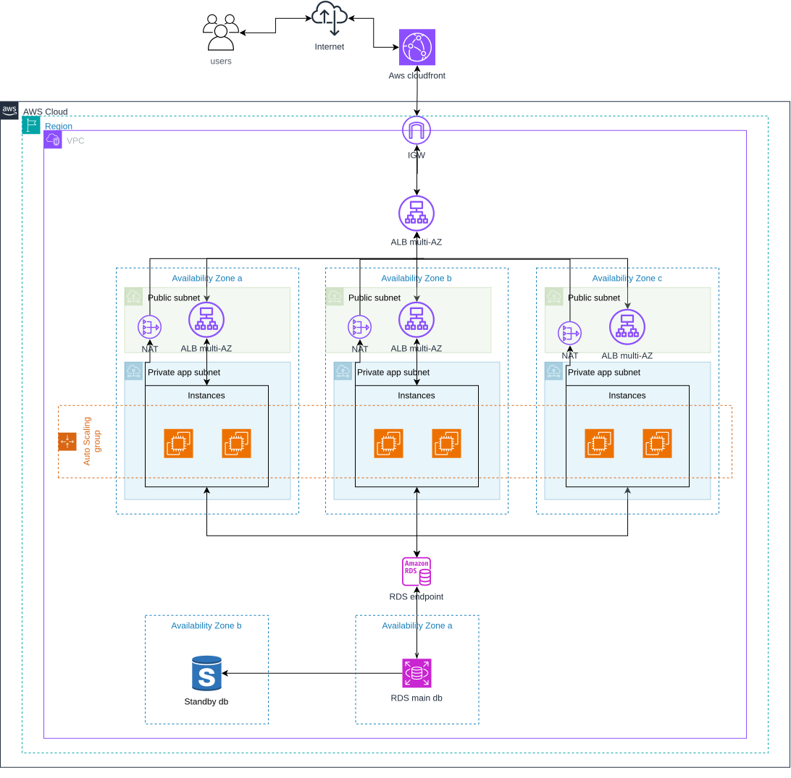

# Three-Tier AWS Architecture with Terraform

A three-tier AWS infrastructure provisioned with Terraform, featuring an Application Load Balancer, an EC2 Auto Scaling Group, and a private Multi-AZ RDS database.

## Architecture



## Overview

- **Networking:** Custom VPC with public, private application, and private database subnets across multiple Availability Zones.
- **Load balancing:** Internet-facing Application Load Balancer distributes HTTP traffic to healthy targets.
- **Compute:** EC2 Auto Scaling Group runs Nginx on private instances and maintains the desired capacity.
- **Database:** Amazon RDS for MySQL with Multi-AZ deployment and no public access.
- **Security:** Security groups control traffic between tiers; Systems Manager Session Manager provides private instance access.
- **Infrastructure as Code:** Terraform manages the infrastructure lifecycle.

## Tech Stack

`AWS` · `Terraform` · `VPC` · `EC2` · `ALB` · `Auto Scaling` · `RDS MySQL` · `IAM` · `Systems Manager` · `Nginx`

## Getting Started

**Prerequisites:** AWS CLI, Terraform, and an AWS account with the required permissions.

Clone the repository and enter the Terraform directory:

```bash
git clone https://github.com/mohammad-ismail-hossen/three-tier-aws-terraform
cd three-tier-aws-terraform/terraform
```

Configure your AWS profile:

```bash
export AWS_PROFILE=~your_aws_profile~
```

Configure the required variables:

```bash
cp terraform.tfvars.example terraform.tfvars
```

Edit `terraform.tfvars` with your database credentials, then initialize and validate:

```bash
terraform init
terraform validate
terraform plan
```

Review the plan before deploying:

```bash
terraform apply
```
Deployed!

## Cleanup

To remove the resources created by Terraform:

```bash
terraform destroy
```

**Note:** NAT Gateways, the load balancer, EC2 instances, and Multi-AZ RDS can incur AWS charges. Destroy the infrastructure when you finish testing.

## License

[LICENSE](LICENSE)